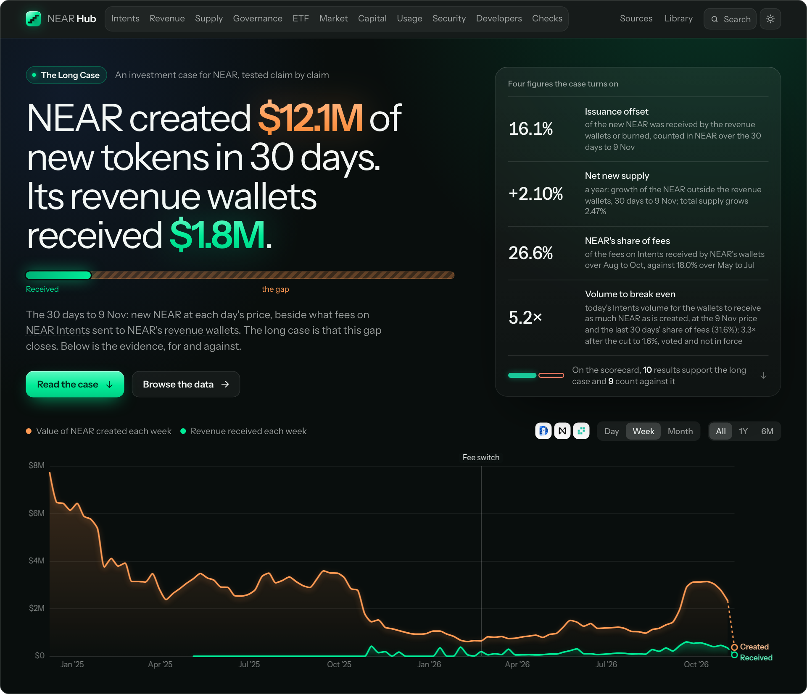
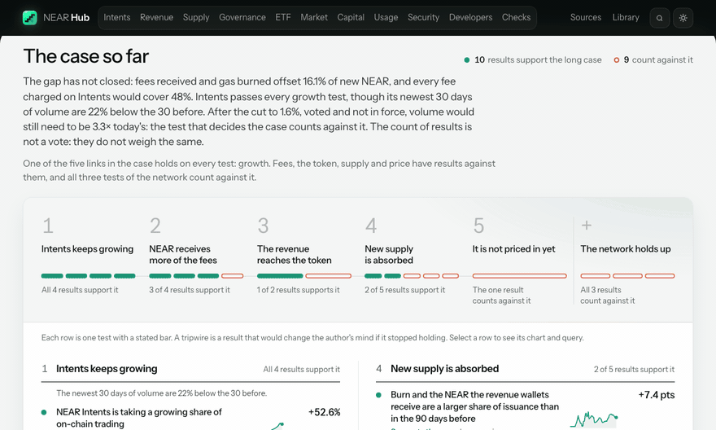
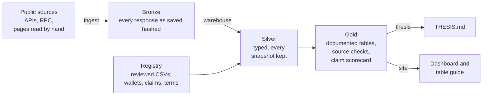

<p align="center">
  <a href="https://nearhub.tech"></a>
</p>

<h1 align="center">NEAR Hub</h1>

<p align="center">
  <b>An investment case for NEAR, tested claim by claim against public data that anyone can rebuild.</b>
</p>

<p align="center">
  <a href="https://nearhub.tech"><b>nearhub.tech</b></a> &nbsp;·&nbsp;
  <a href="THESIS.md">The thesis</a> &nbsp;·&nbsp;
  <a href="https://nearhub.tech/docs/">Guide to every table</a> &nbsp;·&nbsp;
  <a href="#rebuild-it-yourself">Rebuild it yourself</a> &nbsp;·&nbsp;
  <a href="docs/README.md">Method</a>
</p>

<p align="center">
  <a href="https://nearhub.tech"></a>
  <a href="https://github.com/mojtb/near-hub/actions/workflows/ci.yml"></a>
  <a href="LICENSE"></a>
  <a href="DATA_NOTICE.md"></a>
</p>

<p align="center">
  <a href="https://nearhub.tech"></a>
</p>

## Where the case stands

<!-- verdict:start -->
**Not yet.** Over the 30 days to 2026-11-09, the fees NEAR's revenue wallets received and the gas burned offset **16.1%** of the new NEAR the chain created; to match it, Intents volume has to be **5.2×** today's, or **3.3×** once the voted cut of issuance to 1.6% is in force. Volume grew **60%** over the last year; at that pace, with the price and NEAR's share of fees unchanged, that is about **3.5 years** away, or **2.6** after the cut: arithmetic, not a forecast. At the snapshot of 2026-11-12, of 19 claims the data can test, **10** support the long case and **9** count against it; **4** more cannot be tested from public data. The closest result, "NEAR's application fees grew faster than any peer's over the last three complete months", holds by 0.11 points; reversed, the count would be **9** and **10**.
<!-- verdict:end -->

The count is not a vote, because the claims do not weigh the same. [THESIS.md](THESIS.md) says which one decides the
case, where it stands, and what would change the author's mind. A claim that fails stays on the page.

| If you have | Start here |
|---|---|
| One minute | [nearhub.tech](https://nearhub.tech). The sentence at the top is the case, and the panel beside it is where it stands |
| Five minutes | [THESIS.md](THESIS.md): the claim, the evidence for it and against it, and the limits of both |
| Ten minutes | Clone it and run `make all`, which takes about a minute once the clone is done. See `10/10 checks passed`: every table rebuilt on your machine from the raw responses in this repository |

## A short tour

<p align="center">
  <a href="https://nearhub.tech"></a>
</p>

The pictures on this page show the snapshot of 12 November 2026, and they and the demo video were made on
13 November, before the BigQuery tables and the questions drawn from them were added. The site moves with the data.

## What is in this repository

Three things, and each is built from the one before it:

| | What it is | Where |
|---|---|---|
| **The warehouse** | Public on-chain, protocol, wallet and market data, collected every night, typed, joined into one documented set of tables and checked against itself. Every response is kept as it was saved, whole or trimmed with a note, so every number traces back to what a source said on the day it said it | [`data/`](data), [`warehouse/`](warehouse), [`registry/`](registry) |
| **The thesis** | The long case for NEAR as claims that can fail: the evidence for, the evidence against, the limits of both, and what would change the author's mind | [THESIS.md](THESIS.md) |
| **The dashboard** | The case on one page, then a subject at a time: each question with its chart, its reading and the query that produced it | [nearhub.tech](https://nearhub.tech), [`site/`](site) |

Neither the thesis nor the dashboard holds a typed number. Both are generated from the warehouse's claim scorecard, so
when the data moves they move with it, including the words. A claim that stops holding says so by itself.

### The case, as tests that can fail

The home page sets the case out as five links in the order they depend on each other: Intents keeps growing, NEAR
receives more of the fees, the revenue reaches the token, new supply is absorbed, and it is not priced in yet. Under
each link sit its tests. Every test has a stated bar, a measurement, the period it reads and a result, and a row opens
the chart and the query behind it.

### Every answer shows its query

Eleven subjects, from NEAR Intents and revenue to supply, the Bitwise ETF, governance and security. Each is a list of
questions, and each question has its finding as the heading, a chart, a reading in plain words, its sources, and the
SQL that drew it. Save that SQL to a file, run `make query < q.sql`, and the same rows come back from the tables you built.

### A guide to every table

Every finished table and field has a description, a unit, its sources and how far back its history goes. The guide is
on the site at [nearhub.tech/docs](https://nearhub.tech/docs/), and as Markdown in
[docs/DATA_CATALOG.md](docs/DATA_CATALOG.md).

## The problem this solves

Evidence about NEAR is scattered across a dozen services, and they disagree. Active accounts differ by about 2x between two
versions of one API today, and differed by 9x to 18x before April 2026. Some "independent" sources read the same
NEAR-uploaded dataset. Price series are stamped a day apart. Free tiers and endpoints change or disappear. A thesis
built on that is hard to check and easy to fool yourself with.

This warehouse keeps every response it reads, types it, joins it into shared tables, and publishes where sources disagree
instead of picking the convenient number.

## How it is built



Each label on an arrow is a `make` command.

`main` is pinned to one snapshot, the date in `data/PINNED`, so it rebuilds the same tables tomorrow as it does today.
A nightly job collects on the `data/nightly` branch; it is paused while this entry is judged.
[docs/ARCHITECTURE.md](docs/ARCHITECTURE.md) has the layers, the rules each one follows and the reasons for the tools.

## Rebuild it yourself

You need Python 3.11, 3.12 or 3.13 and `make`, on macOS or Linux. `make` uses the first of those it finds, and stops
with a plain message if it finds none; to name one yourself, add `PYTHON=/path/to/python` to the command. No keys and
no API calls are needed: everything is rebuilt from the responses committed in `data/bronze/`. Only `make setup` uses
the network, to download the pinned Python packages.
The command below fetches `main` alone, with its full history: about 140 MB, because every stored response is in it.
A plain `git clone` also fetches every nightly snapshot, which is larger and grows each night.

```bash
git clone --single-branch https://github.com/mojtb/near-hub.git
cd near-hub
make all
```

`make all` runs these five steps in order, in about a minute once the packages are downloaded. Each can also be run
alone.

| Step | Command | You should see | What it shows |
|---|---|---|---|
| 1 | `make setup` | `Setup complete: N packages installed` | The toolchain is pinned in `requirements.lock` |
| 2 | `make warehouse` | `Warehouse built as of ...`, in under a minute | `data/warehouse.duckdb` and `data/gold/` rebuild from the raw responses alone |
| 3 | `make verify` | `10/10 checks passed` | Every raw file still has its recorded hash, the data tests and unit tests pass, and each gold table reproduces its committed fingerprint |
| 4 | `make site` | `Site built as of ...`, in a few seconds | Every number and chart on the dashboard, and the guide to every table, are rewritten from the warehouse you just built |
| 5 | `make thesis` | `wrote THESIS.md: ...` | The thesis is rewritten from the same scorecard, and comes out unchanged unless the warehouse did |

Then:

- **Open the dashboard you built.** Open `site/index.html` in a browser. It needs a network connection for its fonts
  and chart library.
- **Ask the warehouse a question.** Run
  `make query SQL="select check_id, value_a, value_b, status from gold.dq_reconciliation order by status, check_id"`.
  See each comparison between sources. [docs/RECONCILIATION.md](docs/RECONCILIATION.md) says where they agree, where
  they don't, and why.
- **Use a container instead.** Run `docker build -t near-hub . && docker run --rm near-hub`. See the same
  `10/10 checks passed`.

`make help` lists every command.

### Expected results

These lines are generated from the warehouse, and `make verify` fails if they stop matching it.

<!-- expected:start -->
- Data through: **2026-11-11**, the last full UTC day before the pinned snapshot of 2026-11-12; `dq_freshness` lists any source that ends earlier
- Gold tables and columns: **96** and **935**
- Reconciliation: **110** comparisons agree, **15** differ, each with a written explanation
- Issuance over the last 30 days, from supply change plus burn: **2.49%** a year, against **2.50%** in the protocol config
- Circulating supply, built from NEAR's lockup contracts: **1,309.38M** NEAR, **99.84%** of total supply; on 2025-08-26, the last day NearBlocks computed its own, **1,249.72M** against **1,249.65M**
- Captured Intents revenue, all time: **$9.83M** per DefiLlama, **$9.80M** rebuilt from wallet transfers
- Public Intents volume, all time through 2026-11-11, the last full day of the latest Dune reading: **$33.47B** per NearBlocks, **$33.09B** per NEAR's dashboard on Dune
- Chain Signatures: **16** MPC participants with a threshold of **11**
- Largest Intents fee channel, per NEAR's dashboard on Dune as read on 2026-11-12: **swapkit**, with **73%** of listed fees
- Bitwise NEAR ETF shares outstanding: **2,930,000** per the fund, **3,000,000** counted on chain in whole baskets
<!-- expected:end -->

## The track's sample prompt, item by item

The organizers publish a [sample prompt](https://github.com/nearai/near-hackathon-prompt-examples/blob/main/tracks/02-thesis.md)
for this track. This is where each thing it asks for is in this repository.

| The prompt asks for | Where it is here |
|---|---|
| A working hypothesis, tested, with what cuts against it: "cross-chain volume through NEAR Intents is a better leading indicator of real network usage than token price" | It is claim `intents_volume_leads_usage` on the scorecard, and it fails. [THESIS.md](THESIS.md#the-sample-prompts-hypothesis) gives the test and its result; the table is `gold.fct_usage_lead_correlations` |
| SQL against the NEAR BigQuery public dataset for daily active accounts, transaction counts and contract usage, filtered on `block_date` | [`ingest/sql/bigquery/`](ingest/sql/bigquery), one file per query: `transactions_daily.sql` counts transactions and distinct signers by day (`gold.fct_bigquery_chain_daily`), and `actions_daily.sql` counts calls, signers and callers by contract (`gold.fct_bigquery_contract_daily`). Each daily query is cut to its partitions by `block_date`, and priced with a dry run before it runs |
| A pull from the NEAR Intents Explorer API for swap volume | [`ingest/sources/intents.py`](ingest/sources/intents.py) reads it day by day from November 2024; the responses are in `data/bronze/intents_explorer/` and the tables are `gold.fct_intents_1click_daily` and the five beside it |
| One command that rebuilds every chart from raw data | `make all`, from the responses in `data/bronze/`, with no key and no API call |
| A static dashboard page: each chart, the query behind it, and one plain sentence on what it shows | [nearhub.tech](https://nearhub.tech), which is [`site/index.html`](site/index.html). Every question has its finding as the heading, a chart, a reading, and a Query button that shows the SQL that drew it. Two questions on the Usage page and one on the Checks page are drawn from the BigQuery tables |
| `THESIS.md` with the claim, the evidence for it, the evidence against it, and what result would change my mind | [THESIS.md](THESIS.md) has those four sections under those names, and opens with where the case stands |
| Never invent numbers; if a metric cannot be computed from these sources, say so | THESIS.md and the numbers on this page are written by the build from the warehouse, and `make verify` fails when they stop matching it. THESIS.md lists four claims the data cannot settle, and what these sources cannot compute |

## What the warehouse holds

Eleven areas: chain usage and supply, NEAR Intents and revenue, the Intents pool on chain, wallets, security and
staking, capital and DeFi, market and peers, the Bitwise NEAR ETF, developers and governance, the thesis models, and
data quality.

**NEAR's public BigQuery dataset** (`bigquery-public-data.crypto_near_mainnet_us`) is queried too. The SQL is in
[`ingest/sql/bigquery/`](ingest/sql/bigquery), one file per query, and only counts are kept. Over the 680 days read, it
counts exactly the same distinct signers as NearBlocks on every day and the same transactions on 678, so the figures the
site shows are checked day for day. It adds what no other source here gives: accounts by contract, and how many of the
74.9 million accounts that ever signed a transaction came back. And NEAR's own circulating supply table agrees with the
one this warehouse builds from the lockup contracts to within 24 NEAR of 2.1 million locked. The method, the cost and
what it found are in [docs/SOURCES.md](docs/SOURCES.md#bigquery-public-dataset).

<details>
<summary><b>The main tables in each area, and where they come from</b></summary>
<br>

| Area | Main tables in `gold` | Main sources |
|---|---|---|
| Chain usage, supply | `fct_chain_daily`, `fct_supply_daily`, `fct_circulating_supply_daily`, `fct_protocol_config`, `fct_contract_daily`, `fct_receiver_sample_daily`, `fct_bigquery_chain_daily`, `fct_bigquery_contract_daily`, `fct_bigquery_action_daily`, `fct_bigquery_circulating_supply_daily`, `fct_bigquery_signer_cohort_monthly` | NearBlocks, archival RPC, Neardata, NEAR's public BigQuery dataset |
| NEAR Intents, revenue | `fct_intents_daily`, `fct_intents_chain_daily`, `fct_intents_asset_daily`, `fct_intents_fee_channels`, `fct_dune_intents_asset_daily`, `fct_dune_intents_chain_daily`, `fct_dune_intents_swaps_daily`, `fct_dune_intents_tvl_daily`, `fct_dune_intents_tvl_asset_daily`, `fct_dune_dashboard_results`, `fct_intents_1click_daily`, `fct_intents_1click_channel_daily`, `fct_revenue_capture` | DefiLlama, NearBlocks, revenue.near.org, NEAR's dashboard on Dune, Intents Explorer API |
| The Intents pool, on chain | `fct_intents_pool_chain_monthly`, `fct_token_price_daily` | Archival RPC, Coin Metrics, DefiLlama |
| Wallets | `fct_wallet_transfers`, `fct_wallet_counterparties`, `fct_revenue_inflows_daily`, `fct_wallet_balance_daily`, `fct_wallet_holdings`, `fct_token_holders`, `dim_entity` | FastNear, RPC, 1Click, Rhea |
| Security, staking | `fct_validator_summary`, `fct_chain_signatures_daily`, `fct_mpc_state`, `fct_lst_snapshot` | RPC, NearBlocks |
| Capital, DeFi | `fct_protocol_tvl_daily`, `fct_defi_tvl_daily`, `fct_exchange_balance_daily`, `fct_protocol_fees_snapshot`, `fct_stablecoin_assets`, `fct_yield_pools` | DefiLlama |
| Market, peers | `fct_market_daily`, `fct_token_prices`, `fct_peer_daily`, `fct_peer_supply_readings`, `fct_swap_services_daily` | CoinMetrics, Coinbase, DefiLlama, 1Click, Rhea |
| Bitwise NEAR ETF flows | `fct_etf_nrr_daily`, `fct_etf_nrr_chain_daily` | Bitwise's page, archival RPC, SoSoValue through news reports |
| Developers, governance | `fct_dev_activity_weekly`, `fct_repo_snapshot`, `fct_governance_proposals`, `fct_governance_decisions`, `fct_venear_snapshot`, `fct_governance_threads`, `dim_event` | GitHub, RPC, gov.near.org |
| Thesis models | `fct_thesis_scorecard`, `fct_thesis_scorecard_daily`, `dim_claim`, `fct_net_dilution_daily`, `fct_deflation_scenarios`, `fct_intents_unit_economics_monthly`, `fct_intents_channel_economics_monthly`, `fct_intents_concentration_monthly`, `fct_valuation_multiples_daily`, `fct_usage_quality_daily`, `fct_usage_lead_correlations`, `fct_etf_absorption_daily` | The gold tables above, `registry/claims.csv`, `registry/issuance_scenarios.csv` |
| Data quality | `dq_reconciliation`, `dq_freshness`, `dq_revisions`, `dq_ingest_runs`, `dq_provenance`, `dq_bigquery_tables`, `dq_bigquery_reads` | All of the above |

</details>

Every table is also in `data/gold/` as Parquet, so you can read it without building anything.

| To learn | Read |
|---|---|
| What each table and column means | [docs/DATA_CATALOG.md](docs/DATA_CATALOG.md), or the same guide at [nearhub.tech/docs](https://nearhub.tech/docs/) |
| How a response becomes a table | [docs/ARCHITECTURE.md](docs/ARCHITECTURE.md) |
| What each source can and cannot tell you | [docs/SOURCES.md](docs/SOURCES.md) |
| Where sources agree, where they differ, and why | [docs/RECONCILIATION.md](docs/RECONCILIATION.md) |
| How circulating supply is built from the lockup contracts, and what `market_cap_usd` means | [docs/CIRCULATING_SUPPLY.md](docs/CIRCULATING_SUPPLY.md) |
| The words this project uses in a particular way, and how to add a source, a table, a comparison, a claim or a question | [docs/README.md](docs/README.md) |

## Refresh the data

Run `make ingest`. See a status table with one line per dataset. It needs network access and can take about 90 minutes,
because it stays within free-tier limits and fills in history in batches. Keys in `.env` are optional and raise those
limits; copy `.env.example` to start. Without a key, a keyed source is skipped with a clear message.

BigQuery is the one source with no keyless route. It needs a Google Cloud key file and one extra package
(`pip install -r requirements-bigquery.txt`), and it runs with `python -m ingest run --sources bigquery`. It asks
BigQuery what each query would read before running it, and stops at 150 GB a query unless the limit is raised for
that run. Rebuilding from the saved data
needs neither.

A fetch is dated today, which is after the pin, so `make warehouse` alone does not read it. To build with it, run
`make warehouse AS_OF=9999-12-31`, or move the pin as [docs/ARCHITECTURE.md](docs/ARCHITECTURE.md) describes.

Run `make backfill` for the long history jobs. They run in batches, so run it again for more; they can be stopped and
restarted.

A GitHub Action takes a snapshot every night on the `data/nightly` branch and rebuilds the dashboard's data and the
thesis with it. `main` stays on the date in `data/PINNED`, so the expected results above do not drift. Each commit on
that branch holds that night's code and data, so `make setup warehouse verify` rebuilds it.

**The nightly job is paused while this entry is judged, through 18 November 2026;** `main` stays on the snapshot of
12 November.

## Repository map

| Path | What it holds |
|---|---|
| [`THESIS.md`](THESIS.md) | The case, the evidence for and against, and its limits. Written by `make thesis` |
| [`DATA_NOTICE.md`](DATA_NOTICE.md) | What is stored, where it came from, and the terms it is held under |
| [`data/bronze/`](data/bronze) | Every response as it was saved, whole or trimmed with a note, by source and day, with its SHA-256 hash in a manifest |
| [`data/gold/`](data/gold) | The finished tables as Parquet and CSV, with their fingerprints and catalog |
| [`data/state/`](data/state) | Where the long history jobs resume from |
| [`data/PINNED`](data/PINNED) | The snapshot date `main` is built at |
| [`registry/`](registry) | Reviewed CSVs: wallets, tokens, peers, events, the claims and their bars, each source's terms |
| [`ingest/`](ingest) | One fetcher per source, run by `make ingest`; the BigQuery queries are in [`ingest/sql/bigquery/`](ingest/sql/bigquery) |
| [`warehouse/`](warehouse) | The dbt models: silver types each response, gold holds the tables a reader should use, and the data tests |
| [`tools/`](tools) | The build steps: export, verify, catalog, thesis, the site's data and the table guide |
| [`site/`](site) | The dashboard, served at [nearhub.tech](https://nearhub.tech): one page, its data, and the table guide in `site/docs/` |
| [`docs/`](docs) | Method notes: architecture, sources, reconciliation, the catalog and dated audits |
| [`tests/`](tests) | Unit tests for the fetchers, the tools and the warehouse |

## NEAR technologies used

The warehouse reads NEAR directly through RPC and archival RPC, including contract views on `v1.signer` (Chain
Signatures), `intents.near` (NEAR Intents), `meta-pool.near`, `linear-protocol.near`, `lst.rhealab.near` and
`venear.dao` (House of Stake). It tracks NEAR Intents volume, fees and revenue, traces the revenue wallets named on
revenue.near.org, reads what the Intents contract held at every month end since it was deployed, and reads the Bitwise
NEAR ETF's holdings from its staking pool, `bitwise_2.poolv1.near`. No contract is deployed and no transaction is sent.

## Data and licence

What is stored, where it came from, the terms it is held under and how to ask for something to be removed are in
[DATA_NOTICE.md](DATA_NOTICE.md). The [LICENSE](LICENSE) covers the code only; the data remains under each source's own
terms, listed in [registry/sources.csv](registry/sources.csv).

## Origin

This began as an entry in the Investment Thesis track of NEAR HACKATHON 2026. Prizes there are paid in NEAR, so the
author could gain exposure to the asset analysed here, and the thesis says so in its limits. It is an
independent project, not affiliated with the NEAR Foundation, and nothing here is investment advice.

## Disclosures

- **Built during the hackathon window.** All code dates from 2026-10-29 or later. The first snapshot in `data/bronze`
  (2026-10-28) was imported from an earlier scaffold by the same author, `near-deflation-clock`, which is not a
  separate submission; `tools/import_legacy_snapshot.py` records how.
- **Libraries:** dbt-core, dbt-duckdb, DuckDB, requests and pytest, pinned in `requirements.lock`. The dashboard loads
  D3, ECharts and its fonts from a CDN.
- **AI assistance:** written with Claude Code. The three readings of NEAR's dashboard on Dune were taken by an
  AI-driven browser at the author's instruction; [DATA_NOTICE.md](DATA_NOTICE.md) says how.
- **Self-reported data:** figures from NEAR's own dashboard on Dune and from revenue.near.org are NEAR's reports about
  itself. Every table built from them says so, and [DATA_NOTICE.md](DATA_NOTICE.md) says how each reading was taken.

## Contact

[@Mo_DeFi](https://x.com/Mo_DeFi) on X, or open an issue on this repository.
