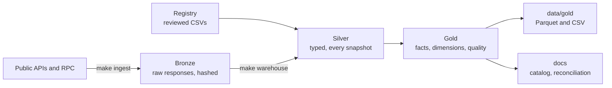

# Architecture

## Layers

| Layer | Where | What it holds | Rule |
|---|---|---|---|
| Bronze | `data/bronze/<source>/<dataset>/dt=<date>/<key>.json.gz` | Responses as received | Never edited. Hashes in `data/bronze/_manifest/`. If a response is trimmed, its manifest note says how |
| Registry | `registry/*.csv` | Reviewed labels: wallets, tokens, peers, events, source terms, ETF flow history | Every label has an evidence level and a source URL |
| Silver | `warehouse/models/silver/`, schema `silver` | One typed model per dataset, every snapshot kept, with `is_latest` on the newest value per key | Faithful to the source. Units converted, nothing joined |
| Gold | `warehouse/models/gold/`, schema `gold` | Shared facts and dimensions | One stated grain per table, tested. Every column documented with a unit |
| Exports | `data/gold/` | Gold as Parquet, CSV for tables up to 5,000 rows, fingerprints, catalog | Rebuilt by `make warehouse` |

## Why these tools

- **DuckDB** needs no server, reads gzipped JSON directly, and runs the same way on a laptop and in CI.
- **dbt** gives tests, documentation and lineage in one place. It is pinned to 1.10 because dbt 1.12 downloads a 49 MB binary while installing, which is a reproducibility risk. `make setup` installs wheels only.
- **Plain JSON in bronze** keeps every source readable without tooling. Values are read as text, so yocto amounts keep every digit.

## Design decisions

**Bronze keeps everything, silver remembers, gold chooses.** Silver holds every snapshot, so a source's later corrections stay visible in `dq_revisions`, and series with a 365-day limit keep growing past it.

**Point-in-time data is captured nightly.** Holdings, top holders, MPC state and the revenue page's current values cannot be fully recovered later. They only exist for dates when a snapshot ran.

**Builds can be pinned.** `data/PINNED` holds a date, and snapshots after it are invisible to the build. That keeps the README's expected numbers true on `main`, while `data/nightly` keeps moving.

**One column per measure.** A gold table holds each measure once. Where several sources measure the same thing, gold takes one, joining sources only where they agree day for day or naming each day's source in a `_basis` column, such as `fct_intents_daily.volume_basis` and `fct_market_daily.price_basis`. Where two sources count different things, both stay under names that say what each counts. Copies of a measure held by another gold table are not repeated: join that table.

**Disagreements are output.** `gold.dq_reconciliation` compares the sources a gold table chooses between, reading them from silver, and marks whether they share an upstream. A gap beyond tolerance needs a written explanation in `registry/reconciliation_notes.csv`, or `make verify` fails.

**Reproducibility is measurable.** Each gold table has a fingerprint: row count and a hash of every row, with doubles rounded to 7 significant digits. `make verify` recomputes them and compares with `data/gold/_fingerprints.json`.

**Credentials stay in headers.** Keys come from the environment, travel only in request headers, and never reach a saved URL or manifest. `make verify` scans the repository for credential shapes.

**One failing source never stops the others.** Each dataset runs on its own, and a run ends with a status table and a report in `data/bronze/_runs/`. A keyed source without its key is skipped with a clear message, and its silver model builds empty.

## Branches and automation

| Branch | Holds | Updated by |
|---|---|---|
| `main` | Code plus the pinned snapshot. What judges run | Commits, and data copied from `data/nightly` when the pin moves |
| `data/nightly` | One commit per night: that night's code and data, pinned to that night, without `.github` | `.github/workflows/nightly.yml` |

`ci.yml` runs `make setup warehouse verify` on a clean Linux machine for every push to `main`. It has no network keys, so it proves the judge path.

`data/nightly` shares no history with `main` and is never merged. Each night the job starts from `main`'s code, brings in the branch's `data/`, and commits the result on top of the branch. Up to `main`'s pin, `main`'s bronze is the record, so a reading added or removed by hand on `main` stays that way. After the pin, the branch's bronze is the record. A commit on the branch passes `make setup warehouse verify` by itself, except on a night the job reports a failed check.

To move the pin: run `git fetch origin data/nightly && git checkout FETCH_HEAD -- data`, then `make warehouse fingerprints catalog verify`, and commit. `data/PINNED` comes along with the data.

## Conventions

- Column names end in their unit where one applies: `_near`, `_usd`, `_yocto`, `_share`, `_rate`, `_pct`.
- `date_day` is a UTC calendar day, and daily series exclude the partial day a snapshot was taken on.
- `_share` and `_rate` are fractions. `_pct` is a percentage.
- 1 NEAR is 10^24 yoctoNEAR. Conversions go through `HUGEINT`, so no digits are lost.
- Models reference bronze through `bronze_files`, which applies the pin and returns nothing if a source has not run.

## Add a source

1. Write a fetcher in `ingest/sources/` with the `@dataset` decorator, then run `python -m ingest run --sources <name>`.
2. Add a row to `registry/sources.csv` with the source's terms.
3. Add the bronze path to `warehouse/models/silver/_bronze.yml` and write a `stg_` model.
4. Add or extend a gold table and document every column in `warehouse/models/gold/_gold.yml`.
5. If it overlaps an existing source, add a check to `dq_reconciliation`.
6. Run `make warehouse fingerprints catalog verify`.
